# nanocode 源码讲解

> 面向零基础的逐行解读。全文不假设你有 agent / LLM 背景。
>
> **前置条件**：只要认识 Python 的基本语法 —— 函数、字典（`{}`）、列表（`[]`）、`if`、`while`、`try/except`。文中出现的每个词都有解释，不用提前懂 LLM。
>
> 阅读建议：按顺序看，每节都能单独看懂。遇到陌生词先跳到 [术语对照表](#附录术语对照表) 查，那张表把每个技术词都翻成了日常说法。
>
> **关于图**：13 张图都是手写的 **SVG**，放在 `docs/assets/`。统一设计：圆角卡片、语义配色（蓝=你、青=程序、紫=AI、绿=文件系统、红=坑），代码用等宽字体，数据流用流动虚线标出，并带 `prefers-reduced-motion` 保护。文本都是原生 `<text>`，GitHub / GitLab / VS Code / Typora 直接可看，不依赖任何插件。要改图：编辑 `docs/assets/figures.py` 里的坐标/文案，然后 `python docs/assets/figures.py` 重新生成；纯手改 `.svg` 也行。

---

## 目录

- [0. 一句话概括](#0-一句话概括)
- [1. 核心机制：一个圈](#1-核心机制一个圈)
  - [1.1 圈长什么样](#11-圈长什么样)
  - [1.2 怎么判断「AI 要干活」](#12-怎么判断ai-要干活)
  - [1.3 `tool_use` 是哪来的](#13-tool_use-是哪来的)
  - [1.4 干完活怎么把结果给回 AI](#14-干完活怎么把结果给回-ai)
  - [1.5 为什么聊天记录每轮都要整个重发](#15-为什么聊天记录每轮都要整个重发)
- [2. 六个工具函数](#2-六个工具函数)
  - [2.1 `read`](#21-read)
  - [2.2 `write`](#22-write)
  - [2.3 `edit`](#23-edit)
  - [2.4 `glob`](#24-glob)
  - [2.5 `grep`](#25-grep)
  - [2.6 `bash`](#26-bash)
- [3. 工具注册表与 schema 生成](#3-工具注册表与-schema-生成)
  - [3.1 `TOOLS` 菜单表](#31-tools-菜单表)
  - [3.2 `make_schema()`](#32-make_schema)
  - [3.3 `run_tool` 唯一的异常出口](#33-run_tool-唯一的异常出口)
- [4. 网络层：`call_api()`](#4-网络层call_api)
- [5. 主循环：`main()`](#5-主循环main)
- [6. 全流程总图](#6-全流程总图)
  - [6.1 泳道图：一次提问的完整来回](#61-泳道图一次提问的完整来回)
  - [6.2 文字版总图](#62-文字版总图)
- [7. 已知问题清单](#7-已知问题清单)
- [附录：术语对照表](#附录术语对照表)
- [最后：怎么自己验证](#最后怎么自己验证)
- [一句话总结](#一句话总结)

**本文用到的图一览**（共 13 张，可按下表跳读）：

| 图 | 类型 | 在哪一节 | 说明 |
|---|---|---|---|
| 三方关系图 | 架构图 | [0](#0-一句话概括) | 谁碰得到硬盘，谁碰不到 |
| 主循环流程图 | 流程图 | [1.1](#11-圈长什么样) | 那个「圈」到底怎么转 |
| content 块分拣图 | 流程图 | [1.2](#12-怎么判断ai-要干活) | 一个 response 怎么被拆开处理 |
| 叫号配对图 | 关系图 | [1.4](#14-干完活怎么把结果给回-ai) | `tool_use_id` 为什么要对上 |
| 历史累积时序图 | 时序图 | [1.5](#15-为什么聊天记录每轮都要整个重发) | 为什么每轮都要整个重发 |
| 工具统一契约图 | 流程图 | [2](#2-六个工具函数) | 六个工具的共同形状 |
| `read` 切片示意 | 示意图 | [2.1](#21-read) | `offset` / `limit` 到底切哪几行 |
| `edit` 唯一性判定 | 决策树 | [2.3](#23-edit) | 为什么必须唯一 |
| schema 转换流水线 | 数据流图 | [3.2](#32-make_schema) | 小表怎么变成 JSON |
| 后端切换分支图 | 分支图 | [4](#4-网络层call_api) | 两套后端怎么切换 |
| 三层嵌套结构图 | 结构图 | [5](#5-主循环main) | 三个 while/for 谁管谁 |
| 全流程泳道图 | 时序图 | [6](#6-全流程总图) | 一次提问的完整来回 |
| `bash` 超时 bug 时序 | 时序图 | [7](#7-已知问题清单) | 为什么超时是假的 |

---

## 0. 一句话概括

**nanocode.py 是个「传话的」**：把你输入发给 AI，AI 说想用哪个工具，它在本机执行，把结果再发回给 AI —— 循环到 AI 不再要工具为止。

为什么需要它？因为 AI 跑在网线那头，**碰不到你的硬盘**。它再聪明也看不见你的文件。所以必须有个本地程序替它动手：

```
AI：  我想调 glob 工具，参数 {"pat": "*.py"}      ← 它只是「说」要调
程序： 好，我在本机替你执行                        ← 手在这里
程序： 执行结果是 nanocode.py                     ← 再把结果告诉它
AI：  哦，那目录里就一个 Python 文件              ← 它据此继续说话
```

### 三方关系：谁碰得到硬盘，谁碰不到

<p align="center">
  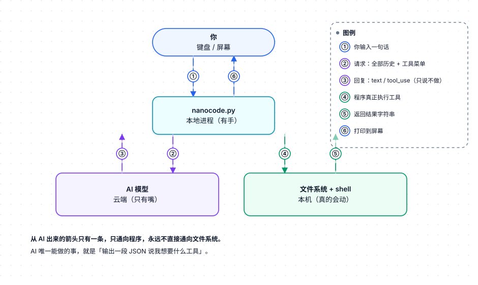
</p>

**盯住一个细节**：从 AI 出来的箭头只有一条，只通向程序，永远不直接通向文件系统。

AI 唯一能做的事就是「输出一段 JSON，说我想要什么工具」。所有真实的磁盘 / 命令操作，都发生在本地这台机器上、在你的 Python 进程里。这就是为什么它叫「传话的」。

**后面所有章节，都是在展开这张图里的某一根箭头。**

---

## 1. 核心机制：一个圈

### 1.1 圈长什么样

整个程序的主干就是一个循环，伪代码只有六行：

```python
while True:                          # 一圈一圈转
    回答 = 问一次 AI(聊天记录)
    要干活 = 回答里有没有 tool_use

    if 要干活:
        干完，把结果加进聊天记录
        继续转圈          # ← 回到 while 顶部
    else:
        停下              # ← 这轮问完了
```

画成流程图，是一个带回头箭头的判断：

<p align="center">
  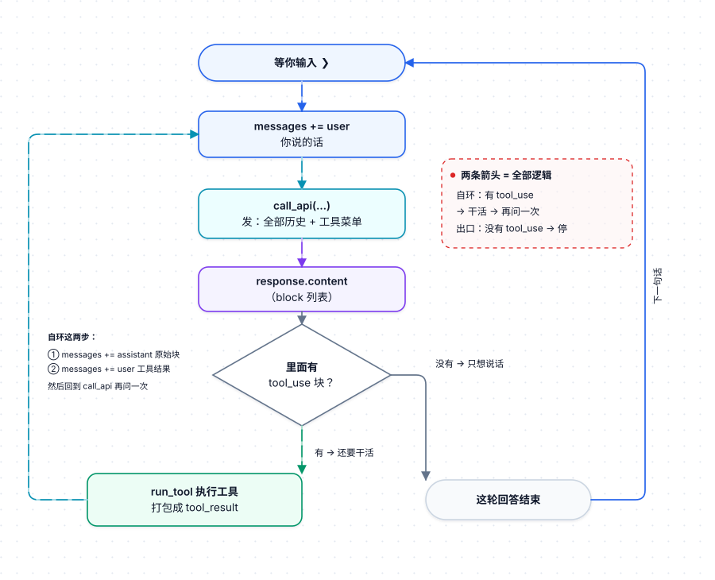
</p>

> 🔑 **核心箭头只有两个**：`有 tool_use → 干活 → 回到 call_api`（自环），和 `没有 tool_use → 结束`（出口）。
> 其余 270 行代码，都是为了支撑这两条箭头。
>
> 💡 **为什么用「有没有 tool_use」判断，而不是让 AI 说"我说完了"？**
> 因为 AI 常常一边说话一边调工具。只有「它这次没要工具」才是可靠的收敛信号。

---

### 1.2 怎么判断「AI 要干活」

AI 返回的不是一句话，是一个**列表**，每项带 `type` 标签：

```python
[
  {"type": "text",     "text": "我先看看有什么文件"},      # ← 说话
  {"type": "tool_use", "name": "glob", "input": {...}}    # ← 要干活
]
```

代码遍历这个列表，按 `type` 分流：

```python
for block in blocks:
    if block["type"] == "text":
        念给你听
    if block["type"] == "tool_use":
        记下来：要干活了          # ← 有这一条，就是"要干活"
```

这个 `for` 循环本质上是个**分拣台**：

<p align="center">
  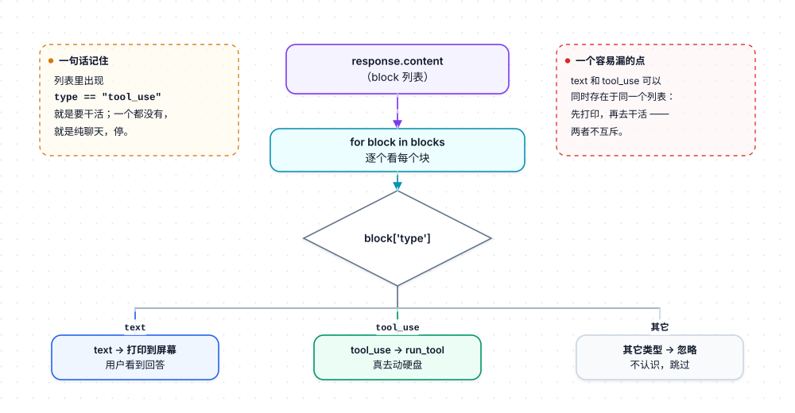
</p>

**一句话记住**：列表里出现 `type == "tool_use"` 的项，就是要干活；一个都没有，就是纯聊天，停。

> 📌 **一个容易漏的点**：同一个列表里可以既有 `text` 又有 `tool_use`。这时程序会先把话打印出来，然后去干活 —— 两者不互斥。

---

### 1.3 `tool_use` 是哪来的

**AI 自己写出来的。**

因为每次问它的时候，除了聊天记录，还附了一份**菜单**（下例为改写简化，真实请求里每项还有 `input_schema`）：

```json
{
  "tools": [
    {"name": "glob", "description": "Find files by pattern..."},
    {"name": "read", "description": "Read file..."}
  ]
}
```

顺序是这样：

1. 你发请求，里面带菜单
2. AI 读到菜单，知道有 `glob` 这个工具、它用来找文件
3. AI 决定用它 → **按菜单的格式**输出 `tool_use` 块
4. 你的程序收到，看到 `type == "tool_use"` → 去执行

AI 输出的东西长这样：

```json
{"type": "tool_use", "name": "glob", "input": {"pat": "*.py"}}
```

> ⚠️ **注意**：AI 只是「说」要用工具，它自己碰不到你的硬盘。真正执行的是你的 Python 代码。

菜单由 `make_schema()` 生成，见 [第 3 节](#3-工具注册表与-schema-生成)。

---

### 1.4 干完活怎么把结果给回 AI

程序执行完工具，得到一个字符串（比如 `"nanocode.py"`）。然后打包成这个格式追加进聊天记录：

```python
{
  "type": "tool_result",
  "tool_use_id": "toolu_01ABC",   # ← 对应 AI 那条 tool_use 的 id
  "content": "nanocode.py"
}
```

一条工具结果就是上面这样一个字典。一轮里可能有多条，所以它们被装进一个**列表**，作为一条 `role: "user"` 消息发回去：

```python
messages.append({"role": "user", "content": tool_results})
#                                          ↑ 多条结果组成的列表
```

**两个容易懵的点：**

| 点 | 说明 |
|---|---|
| **`tool_use_id` 必须对上** | AI 可能一口气要干 3 件事，就回 3 条结果，靠 id 对号入座 |
| **角色是 `user`，虽然这是工具结果** | Messages API 规定角色必须交替（user → assistant → user），工具结果在协议上属于 user 侧输入 |

**为什么 `tool_use_id` 必须对上 —— 一次调三个工具的情况：**

<p align="center">
  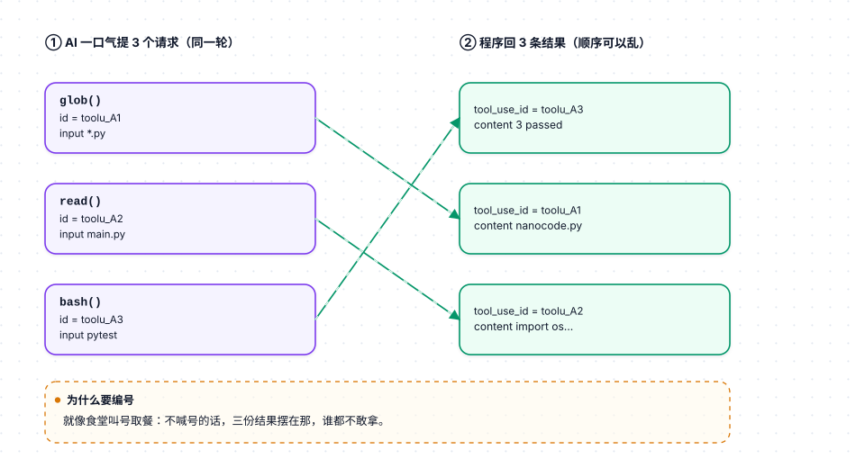
</p>

> 💡 **为什么要编号？** 就像食堂叫号取餐：不喊号的话，三份餐摆在那谁都不敢拿。

**id 丢了会怎样？** AI 拿到三条结果，不知道哪条属于哪个请求。所以代码里存的是**原始返回** `content_blocks`，而不是重新拼的字符串 —— 为的就是把 id 原样留住。

---

### 1.5 为什么聊天记录每轮都要整个重发

因为 **AI 那边没有记忆**。

每次调 API，对它来说都是**第一次见面**。上一轮说了啥、干了啥，它全不知道。

所以只能这样：每转一圈，都把 `messages` 里**全部历史**重新发一遍。

```python
messages = [
  {"role": "user",      "content": "有什么文件?"},        # 第1条
  {"role": "assistant", "content": [text, tool_use]},     # 第2条
  {"role": "user",      "content": [tool_result]},        # 第3条
]
```

第二次请求时，这**三条全发**。AI 读了这三条，才知道「哦，刚才我问过要 glob，现在结果回来了」。

**下面这张时序图，重点看「程序 → AI」那几根箭头上挂的内容：一次比一次长。** 这就是「整个重发」：

<p align="center">
  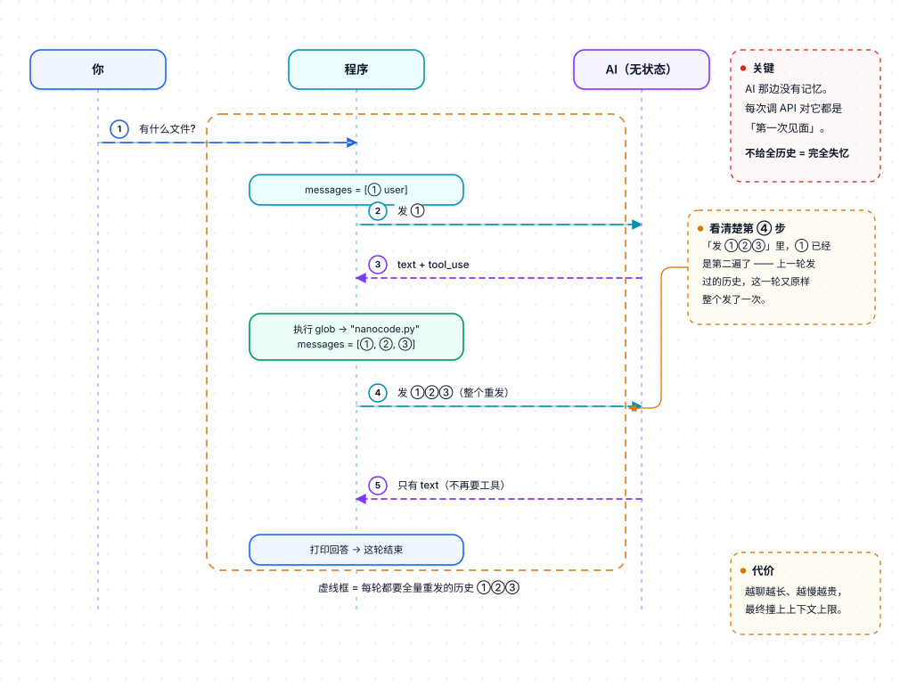
</p>

> 💡 **看出来了吗**：第三次发出去时，第 1 条被**重复发送**了。看起来浪费，但这是 API 无状态设计的必然代价 —— 也是程序简单的来源：不需要在本地维护任何「AI 记得什么」的状态。

**代价**：聊得越久，`messages` 越长，每次发的东西越多，越慢越贵。所以长会话最终会撞上上下文上限。

**好处**：程序逻辑极简。不需要在本地维护任何「AI 记得什么」的状态，**`messages` 就是全部真相**。

---

## 2. 六个工具函数

统一契约：**入参是一个字典，出参是一个字符串**（直接当 `tool_result.content` 用）。

六个工具形状完全一致 —— **进去是参数，出来是字符串，中间无论怎么炸都不会漏到外面**：

<p align="center">
  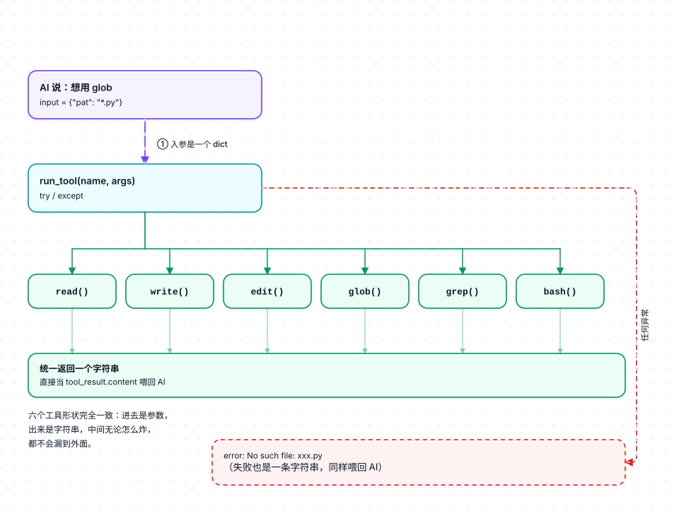
</p>

**这张图的第二个重点是那条「任何异常」的虚线箭头**：失败不会让程序退出，而是绕个弯变成一条**同样是字符串**的结果（虚线框那个节点）。对 AI 来说，「成功的结果」和「失败的结果」长得一样，都得读一遍 —— 于是它就学会了自我纠正。

没有任何工具会把异常抛到外面 —— 全部在 `run_tool` 里兜住（见 [3.3](#33-run_tool-唯一的异常出口)）。

---

### 2.1 `read`

```python
def read(args):
    lines = open(args["path"]).readlines()          # 整个文件读成行列表
    offset = args.get("offset", 0)                  # 从第几行开始，默认 0
    limit = args.get("limit", len(lines))           # 要几行，默认全要
    selected = lines[offset : offset + limit]        # 切一段
    return "".join(f"{offset + idx + 1:4}| {line}" for idx, line in enumerate(selected))
```

**做的四件事：**

1. 打开文件，按行拆成列表
2. 按 `offset` / `limit` 切出一段（大文件不用全给）
3. 每行前面加**行号**（`   1| `），方便 AI 后面精确改
4. 拼成一个字符串返回

**`offset` / `limit` 到底切哪几行**（`offset=2, limit=3` 的例子）：

<p align="center">
  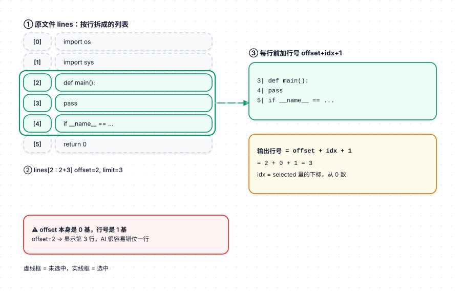
</p>

对应到具体每一行（**虚线框 = 未选中，粗实线框 = 选中**）：

| i | 原文件内容 | 选中？ | 输出 |
|---|---|---|---|
| 0 | `import os` | ✗ | — |
| 1 | `import sys` | ✗ | — |
| 2 | `def main():` | ✓ | `   3\| def main():` |
| 3 | `    pass` | ✓ | `   4\|     pass` |
| 4 | `if __name__ …` | ✓ | `   5\| if __name__ …` |
| 5 | `    return 0` | ✗ | — |

换算关系：

```
输出行号 = offset + idx + 1
         =   2   +  0  + 1 = 3      ✓ 对应原文件第 3 行
```
> （`idx` 是 `selected` 里的位置，从 0 数）

> ⚠️ **这里有个坑**（详见 [第 7 节](#7-已知问题清单)）：`offset` 本身是 **0 基**（`offset=2` 跳过前 2 行），但显示出来的行号是 **1 基**。AI 很容易以为 `offset` 也数 1 基，从而错位一行。

**为什么加行号**：AI 之后要 `edit` 时，得说「改第 20 行」，没有行号它就对不准。

**为什么限制行数**：上下文窗口装不下整个文件。给太多，AI 反而会看漏关键部分。

---

### 2.2 `write`

```python
def write(args):
    with open(args["path"], "w") as f:
        f.write(args["content"])
    return "ok"
```

**三行，做一件事：把 `content` 整个写进 `path`。**

- `"w"` 模式 = 覆盖。文件原来有什么，全没了
- 返回值固定是 `"ok"`，AI 看到就知道写成功了

**注意**：它不检查目录存在不存在，不检查有没有权限。出错就抛异常，被外面的 `run_tool` 兜住，变成 `"error: ..."` 字符串给 AI 看。

---

### 2.3 `edit`

> 六个工具里最有意思的一个 —— 带「必须唯一」的安全保护。

```python
def edit(args):
    text = open(args["path"]).read()        # 整个文件读成字符串
    old, new = args["old"], args["new"]     # 要替换的旧文本 / 新文本

    if old not in text:
        return "error: old_string not found"          # 找不到

    count = text.count(old)
    if not args.get("all") and count > 1:
        return f"error: old_string appears {count} times, must be unique (use all=true)"

    replacement = text.replace(old, new) if args.get("all") else text.replace(old, new, 1)
    with open(args["path"], "w") as f:
        f.write(replacement)
    return "ok"
```

**三步：**

1. **找不到** `old` → 直接报错返回，不写文件
2. **找到多处** → 也报错，除非 AI 明说 `all=true`
3. 都没问题 → 替换并写回

画成决策树，就是这个岔路 —— **只有一条路能走到「写文件」**：

<p align="center">
  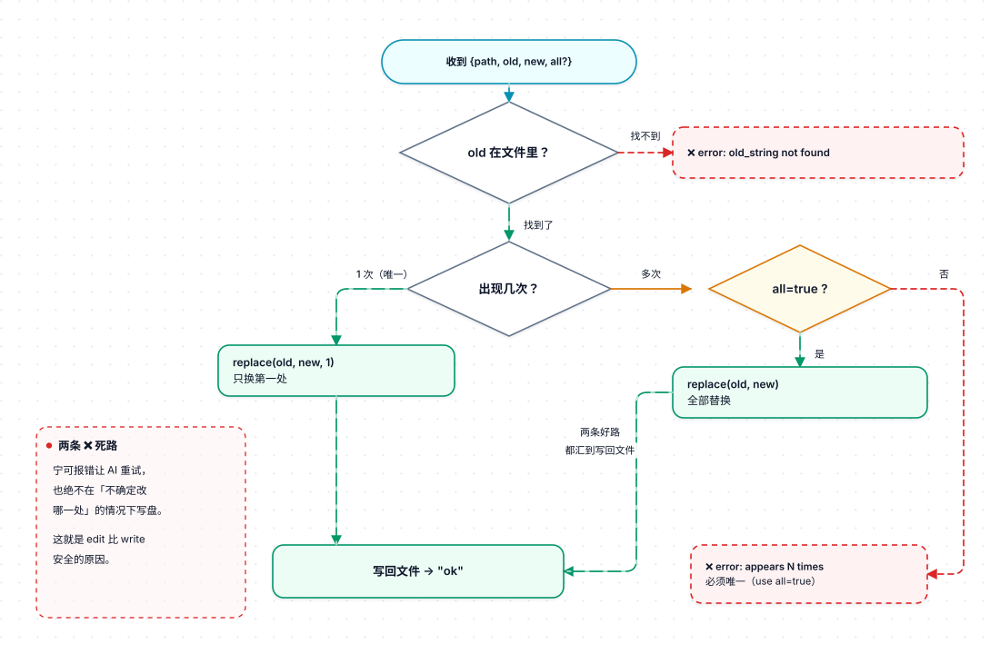
</p>

**注意那两条标了 ❌ 的虚线死路 —— 这就是 `edit` 比 `write` 安全的原因**：宁可报错让 AI 重试，也绝不在「不确定改哪一处」的情况下动手写盘。

**为什么必须唯一？**

假设 AI 说"把 `return` 改成 `return None`"。文件里有 5 个 `return`，到底改哪个？**猜错了就毁代码**。

所以逼 AI **把上下文写长**，长到只匹配一处：

```python
old: "def foo():\n    return"
```

这样才安全。报错信息里直接告诉它 `use all=true`，AI 一看就懂怎么改。

---

### 2.4 `glob`

```python
def glob(args):
    pattern = (args.get("path", ".") + "/" + args["pat"]).replace("//", "/")
    files = globlib.glob(pattern, recursive=True)
    files = sorted(
        files,
        key=lambda f: os.path.getmtime(f) if os.path.isfile(f) else 0,
        reverse=True,
    )
    return "\n".join(files) or "none"
```

**三步：**

1. **拼路径**：`path + "/" + pat`，比如 `./` + `**/*.py`。`replace("//", "/")` 是防手滑拼出双斜杠
2. **找**：`globlib.glob(..., recursive=True)`，只有 `recursive=True` 时 `**` 才能递归进子目录
3. **排序**：按**修改时间**倒序，最近改过的排最前

**为什么按时间排而不是字母排？**

因为 AI 找文件通常是为了改它。**刚改过的文件大概率就是现在要动的那个**。字母序对 AI 没用，时间序有用。

**两个防御细节：**

- `getmtime` 对目录会出错（只有文件有 mtime），所以加了 `if os.path.isfile(f) else 0` 兜住
- `or "none"` 是空列表时返回 `"none"` —— 不然返回空字符串，AI 会以为工具挂了

---

### 2.5 `grep`

```python
def grep(args):
    pattern = re.compile(args["pat"])
    hits = []
    for filepath in globlib.glob(args.get("path", ".") + "/**", recursive=True):
        try:
            for line_num, line in enumerate(open(filepath), 1):
                if pattern.search(line):
                    hits.append(f"{filepath}:{line_num}:{line.rstrip()}")
        except Exception:
            pass
    return "\n".join(hits[:50]) or "none"
```

**三个步骤（两层循环 + 一个收集动作）：**

1. **外层（遍历文件）**：遍历目录下所有文件（`/**` 递归）
2. **内层（遍历行）**：逐行读每个文件
3. **匹配后（收集）**：命中就拼成 `文件:行号:内容` 存进 `hits`

最后只返回**前 50 条**。

**两个细节：**

- `except Exception: pass` —— 遇到二进制文件、没权限的文件、编码错的，**静默跳过**。不跳过的话，搜一次仓库就崩了
- `line.rstrip()` —— 去掉行尾换行符，不然拼出来格式乱

**输出格式为什么是 `文件:行号:内容`？**

刻意的。AI 看到 `main.py:20: return None` 就知道「去 main.py 第 20 行」，能直接接着 `read` 或 `edit`。

**缺点**：虽然有 `hits[:50]`，但文件还是**全部读完了**才截断，没提前退出。大仓库会很慢。

---

### 2.6 `bash`

```python
def bash(args):
    proc = subprocess.Popen(
        args["cmd"], shell=True,
        stdout=subprocess.PIPE, stderr=subprocess.STDOUT,
        text=True
    )
    output_lines = []
    try:
        while True:
            line = proc.stdout.readline()          # 逐行读
            if not line and proc.poll() is not None:
                break                               # 没输出且进程结束了
            if line:
                print(f"  {DIM}│ {line.rstrip()}{RESET}", flush=True)   # 实时打印
                output_lines.append(line)
        proc.wait(timeout=30)
    except subprocess.TimeoutExpired:
        proc.kill()
        output_lines.append("\n(timed out after 30s)")
    return "".join(output_lines).strip() or "(empty)"
```

**要点：**

| 设计 | 原因 |
|---|---|
| **`Popen` 而不是 `run`** | 要能边跑边看输出。`run` 得等命令跑完才一次性给结果 |
| **`stderr=subprocess.STDOUT`** | 把错误输出并进标准输出，报错也能被 AI 看到（很重要） |
| **`readline()` 循环** | 读到一行就打印一行（带 `│` 前缀），同时存起来 |
| **实时打印** | 长命令（比如 `npm install`）你能看到进度，不是干等 |

**⚠️ 那个超时是坏的：**

```python
while True:
    line = proc.stdout.readline()   # ← 这里能无限阻塞
...
proc.wait(timeout=30)               # ← 超时写在这，走不到
```

如果命令不输出任何东西（比如 `sleep 100`），`readline()` 就一直卡着，30 秒超时根本轮不到执行。**实际等于没有超时**。

> 完整分析和修复方案见 [第 7 节](#7-已知问题清单) 第一条。

---

## 3. 工具注册表与 schema 生成

这一节是省代码的核心技巧：**写一个小表，自动生成 API 要的 JSON Schema**。

### 3.1 `TOOLS` 菜单表

```python
TOOLS = {
    "read": (
        "Read file with line numbers (file path, not directory)",   # 描述
        {"path": "string", "offset": "number?", "limit": "number?"}, # 参数表
        read,                                                        # 函数本体
    ),
    "write": ("Write content to file", {"path": "string", "content": "string"}, write),
    "edit":  ("Replace old with new in file (old must be unique unless all=true)",
              {"path": "string", "old": "string", "new": "string", "all": "boolean?"}, edit),
    "glob":  ("Find files by pattern, sorted by mtime", {"pat": "string", "path": "string?"}, glob),
    "grep":  ("Search files for regex pattern",         {"pat": "string", "path": "string?"}, grep),
    "bash":  ("Run shell command",                       {"cmd": "string"}, bash),
}
```

**每一项是三元组：`(描述, 参数表, 函数)`**

| 元素 | 给谁看 | 作用 |
|---|---|---|
| **描述** | AI | 让它知道这工具干啥 |
| **参数表** | AI | 告诉它要传什么参数 |
| **函数** | 程序自己 | AI 要调时就去执行它 |

**参数表里那个 `?`**：`"number?"` 表示可选，`"number"` 表示必填。

**为什么要这么写？** 因为 `make_schema()` 要把这张表翻译成 API 认识的 JSON 格式。手写 JSON 太长太容易错，这样写表达更紧凑。

> 🔍 **记住 `[2]` 这个下标**：下一节 `run_tool` 里会用 `TOOLS[name][2]` 取函数 —— 三元组的第 3 个元素（下标 2）。

---

### 3.2 `make_schema()`

```python
def make_schema():
    result = []
    for name, (description, params, _fn) in TOOLS.items():
        properties = {}
        required = []
        for param_name, param_type in params.items():
            is_optional = param_type.endswith("?")          # 有问号=可选
            base_type = param_type.rstrip("?")              # 去掉问号
            properties[param_name] = {
                "type": "integer" if base_type == "number" else base_type
            }
            if not is_optional:
                required.append(param_name)                 # 没问号的进必填
        result.append({
            "name": name,
            "description": description,
            "input_schema": {
                "type": "object",
                "properties": properties,
                "required": required,
            },
        })
    return result
```

**输入 → 输出：**

表里这一行：

```python
"read": ("Read file...", {"path": "string", "offset": "number?"}, read)
```

翻译成（JSON，这个是真的合法 JSON，可直接拿去请求）：

```json
{
  "name": "read",
  "description": "Read file...",
  "input_schema": {
    "type": "object",
    "properties": {
      "path":   {"type": "string"},
      "offset": {"type": "integer"}
    },
    "required": ["path"]
  }
}
```

**对比一下就看出来了**：`offset` 的 `?` 被吃掉了，但也没进 `required` —— 这就是「可选」在 JSON Schema 里的表达方式（不在 `required` 里就是可选）。

**干的就三件事：**

1. 去掉 `?`，记下谁是可选
2. `number` 翻译成 JSON Schema 里的 `integer`
3. 没 `?` 的参数塞进 `required` 列表

> 注：JSON Schema 里 `integer` 和 `number` 是不同的 —— `integer` 只接受整数。这里把 `number` 映射成 `integer` 实际上略有偏差（`number` 本应允许小数），但对 `offset` / `limit` 这种参数刚好合适。

**把它看成一条流水线，数据每过一站就变一次形：**

<p align="center">
  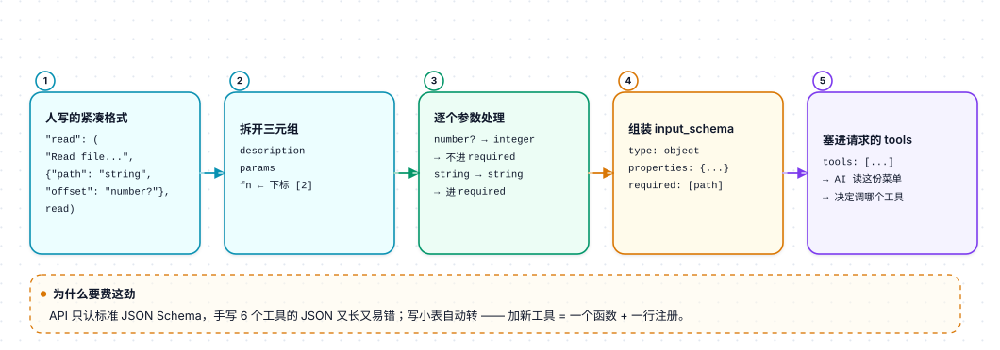
</p>

**为什么要费这劲？** 因为 API 只认标准 JSON Schema。但手写 6 个工具的 JSON 又长又容易错，还不如写这张小表，自动转。

> 💡 好处：**加一个新工具 = 写一个函数 + 加一行注册**，schema 自动生成。

---

### 3.3 `run_tool` 唯一的异常出口

```python
def run_tool(name, args):
    try:
        return TOOLS[name][2](args)
    except Exception as err:
        return f"error: {err}"
```

**把异常转成字符串喂回模型** —— 这是 agent 设计里非常关键的一招：

> 工具失败不是程序崩溃，而是给模型的一条可读反馈，让它自己纠正。

比如 AI 说「读一下 xxx.py」，但根本没这个文件。普通程序会直接崩溃；但这里会返回一条字符串（实际内容大致如下）：

```
error: [Errno 2] No such file or directory: 'xxx.py'
```

AI 看到就会想：「哦，我记错名字了，换个路径试试」。

**这就是它看起来「很聪明」的原因** —— 不是模型聪明，是错误被当成消息传回去了，模型有机会自我修正。

---

## 4. 网络层：`call_api()`

```python
def call_api(messages, system_prompt):
    request = urllib.request.Request(
        API_URL,
        data=json.dumps({
            "model": MODEL,
            "max_tokens": 8192,
            "system": system_prompt,      # "你是个简洁的编程助手，当前目录是X"
            "messages": messages,          # 全部聊天记录
            "tools": make_schema(),        # 3.2 生成的菜单
        }).encode(),
        headers={
            "Content-Type": "application/json",
            "anthropic-version": "2023-06-01",
            **({"Authorization": f"Bearer {OPENROUTER_KEY}"} if OPENROUTER_KEY
               else {"x-api-key": os.environ.get("ANTHROPIC_API_KEY", "")}),
        },
    )
    response = urllib.request.urlopen(request)
    return json.loads(response.read())
```

**四件事：**

1. **拼 body**：模型名 + 聊天记录 + 菜单 + 系统提示
2. **拼 header**：告诉服务器"我是谁"（哪个 key）
3. **发出去**，等回来
4. **解析 JSON**，直接返回字典

**那个 `**({...} if ... else {...})` 是什么意思？**

根据有没有 `OPENROUTER_KEY` 决定用哪套认证：

| 条件 | Header |
|---|---|
| 有 `OPENROUTER_KEY` | `Authorization: Bearer xxx`（OpenRouter 格式） |
| 没有 | `x-api-key: xxx`（Anthropic 官方格式） |

`**` 是把字典拆开塞进 header。

**一个环境变量，决定整条链路走向：**

<p align="center">
  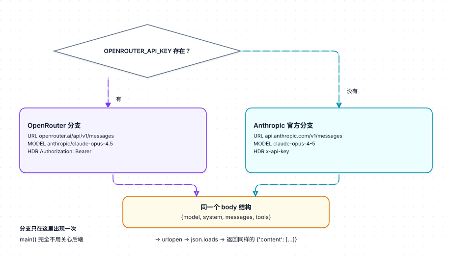
</p>

> 💡 **注意两条分支最后汇到同一个 body**。这是整个设计能成立的前提：OpenRouter 的 `/v1/messages` 端点兼容 Anthropic 格式，所以 `main()` 里那几十行代码**完全不用关心后端是谁** —— 分支只在这里出现一次。

**零依赖**：用 `urllib` 而不是 `requests`，所以整个项目不需要 `pip install` 任何东西。

**相关配置（文件开头）：**

```python
OPENROUTER_KEY = os.environ.get("OPENROUTER_API_KEY")
API_URL = "https://openrouter.ai/api/v1/messages" if OPENROUTER_KEY else "https://api.anthropic.com/v1/messages"
MODEL = os.environ.get("MODEL", "anthropic/claude-opus-4.5" if OPENROUTER_KEY else "claude-opus-4-5")
```

**⚠️ 缺陷 —— 两种不同的致命情形：**

| 情形 | 发生什么 | 用户看到 |
|---|---|---|
| **HTTP 错误**（429 / 500 / 网络不通） | `urlopen()` 抛 `HTTPError`，被外层 `except` 捕到 | 打印一行 `⏺ Error: ...`，OK |
| **API 返回 `{"error": {...}}`**（额度不足、模型不存在等） | `response.get("content", [])` 得到空列表 → `tool_results` 为空 → 内层循环 `break` | **什么都不打印**，直接回到提示符，回答凭空消失 |

第二种最坑：**既不报错，也不输出**。修法是在 `json.loads` 后先判 `"error" in data`，把它当异常抛出去。

---

## 5. 主循环：`main()`

把前面所有零件串起来。

```python
def main():
    print(f"{BOLD}nanocode{RESET} | ...")        # 打个欢迎横幅
    messages = []                                # 聊天记录，空的
    system_prompt = f"Concise coding assistant. cwd: {os.getcwd()}"

    while True:                                  # ① 外层：等你输入
        print(separator())
        user_input = input("❯ ").strip()

        if not user_input: continue              # 空输入跳过
        if user_input in ("/q", "exit"): break    # 退出
        if user_input == "/c":                    # 清空记录
            messages = []
            continue

        messages.append({"role": "user", "content": user_input})   # 记下你说的话

        while True:                              # ② 内层：agentic loop
            response = call_api(messages, system_prompt)
            content_blocks = response.get("content", [])
            tool_results = []

            for block in content_blocks:                              # ③ 遍历每个块
                if block["type"] == "text":
                    print(f"\n⏺ {render_markdown(block['text'])}")   # 念给你听

                if block["type"] == "tool_use":
                    result = run_tool(block["name"], block["input"])  # 干活
                    tool_results.append({
                        "type": "tool_result",
                        "tool_use_id": block["id"],                   # 对号
                        "content": result,
                    })

            messages.append({"role": "assistant", "content": content_blocks})

            if not tool_results:                 # ④ 没要干活 → 停
                break

            messages.append({"role": "user", "content": tool_results})
```

**嵌套结构长这样 —— 三个圈，大的包小的（框套框，一眼看出谁包谁）：**

<p align="center">
  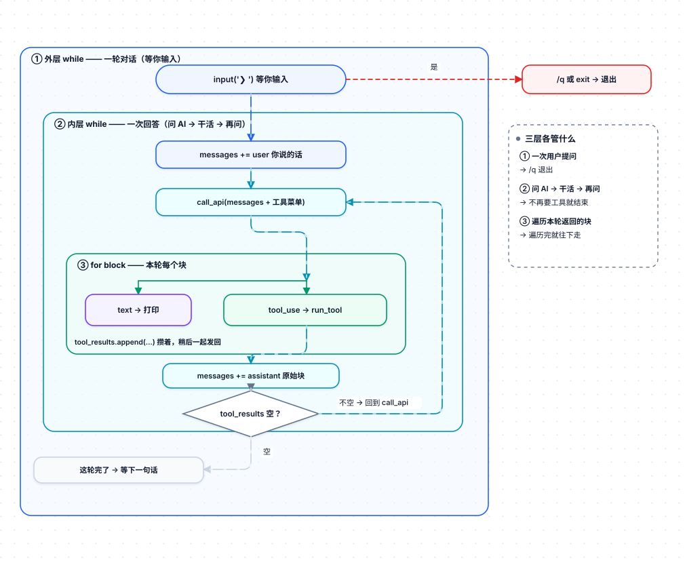
</p>

**三个层次：**

| 层 | 循环的是什么 | 何时结束 |
|---|---|---|
| **外层 while ①** | 一次用户提问 | 你打 `/q` 或 Ctrl+C |
| **内层 while ②** | 「问 AI → 干活 → 再问 AI」 | AI 不再要求用工具 |
| **for block ③** | 这一轮返回里的每个块 | 遍历完所有块 |

**关键三行：**

```python
messages.append({"role": "user",      "content": user_input})      # 你说的话
messages.append({"role": "assistant", "content": content_blocks})  # AI 的原始返回（存原件！）
messages.append({"role": "user",      "content": tool_results})    # 工具结果
```

**为什么 assistant 存的是 `content_blocks` 而不是重新拼的字符串？**

因为里面有 `tool_use.id`，下一轮 `tool_result` 要引用它，丢了就对不上号。**存原件最省事。**

**那个 `/c` 清空** 就是直接把 `messages = []`，历史全扔，等于重开。

**为什么工具结果要在 `for` 循环之后才批量追加？**

工具在 `for` 里就执行了（这样能边执行边打印），但结果统一在循环末尾作为**一条** user 消息批量追加。这是 Anthropic 的要求 —— 一轮里所有 `tool_result` 必须放在同一个 user 消息里。

---

## 6. 全流程总图

### 6.1 泳道图：一次提问的完整来回

这张图把「谁在什么时候做什么」按时间从左到右排开，四条泳道分别是**你**、**程序**、**文件系统**、**AI**：

<p align="center">
  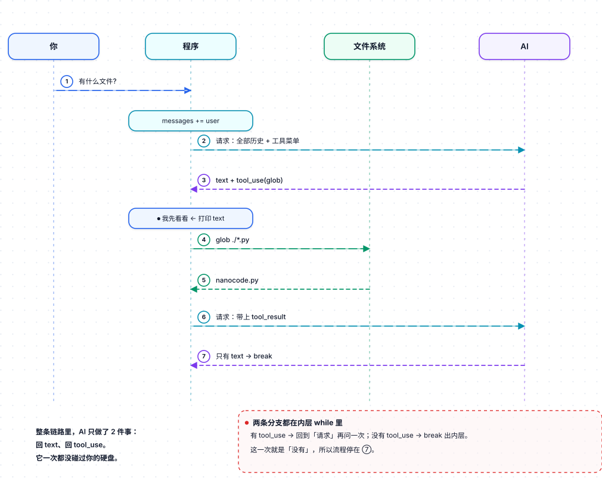
</p>

### 6.2 文字版总图

（如果上面的图加载不出来，看这个。）

```text
输入 "what files are here?"
│
├─ messages 追加 user 消息
│
└─▶ 进入【内层 while】——反复执行下面这整串：
    │
    ├─ 1. call_api(messages + 菜单)  ──▶  发给 AI
    │
    ├─ 2. 拿到 content 列表，逐块判断：
    │        ├─ type == text     → 打印到屏幕
    │        └─ type == tool_use → run_tool() 干活
    │                               └─ 打包成 tool_result，攒进列表
    │
    ├─ 3. messages += assistant 原始块
    │
    └─ 4. tool_results 为空吗？
             ├─ 否 → 追回 user 工具结果，回到第 1 步
             └─ 是 → 跳出内层 while
│
└─▶ 等下一句话
```

**为什么一轮可能要调好几次 API？**

因为一件事往往干不完。比如「帮我修个 bug」：

```text
你：帮我修个 bug
AI：先找找相关文件      → 【glob】
程序：找到了 main.py
AI：读一下               → 【read】
程序：这是内容……
AI：第 20 行改一下        → 【edit】
程序：改好了
AI：跑一下测试           → 【bash】
程序：测试失败了，报错是……
AI：那再改一下           → 【edit】
程序：改好了
AI：跑测试               → 【bash】
程序：通过了
AI：搞定了，问题是……
```

**每一步都是：发请求 → 拿到工具调用 → 干活 → 把结果回灌。**

这就是 agent 这个词的全部意思 —— **不是你问一句他答一句，而是他自己一轮一轮地干活，直到干完。**

---

## 7. 已知问题清单

按严重程度排。

### 🔴 `bash` 的超时是假的

```python
while True:
    line = proc.stdout.readline()   # ← 这里会无限阻塞
    ...
proc.wait(timeout=30)               # ← 超时检查写在这里，永远走不到
```

命令不产出任何输出（比如 `sleep 100`）时，`readline()` 就一直卡着，30 秒超时根本轮不到执行。**实际等于没有超时**。

**为什么会死在那儿 —— 看这个时序：**

<p align="center">
  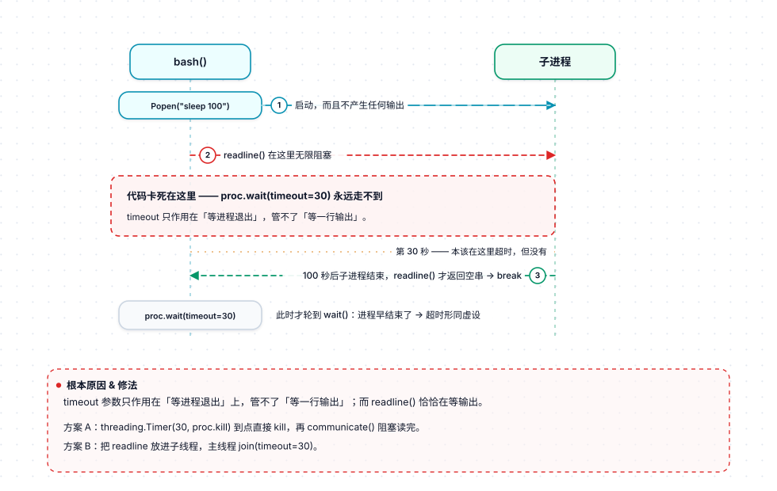
</p>


**根本原因**：`timeout` 参数只作用在「等进程退出」上，**管不了「等一行输出」**。而 `readline()` 恰恰是在等输出。

修复思路（任选其一）：

```python
# 方案 A：timer 到点直接 kill
import threading
timer = threading.Timer(30, proc.kill)
timer.start()
try:
    out, _ = proc.communicate()   # 阻塞读完（交给 timer 保底打断）
finally:
    timer.cancel()

# 方案 B：扫描时用 select（仅 Unix）
# 方案 C：把 readline 放到子线程，主线程 join(timeout=30)
```

### 🔴 `call_api` 没有错误处理

```python
return json.loads(response.read())
```

两种不同的失败情形，后果不一样：

- **HTTP 错误**（429/500/网络不通）→ `urlopen()` 抛异常 → 外层捕获 → 能看到一行 `⏺ Error: ...`
- **API 返回 `{"error": ...}`**（额度不足等）→ `response.get("content", [])` 得到空列表 → `tool_results` 为空 → **静默 break，什么都不打印**

后者最难排查。应该在返回前先判 `if "error" in data: raise Exception(data["error"])`，同时把 `HTTPError` 的 body 读出来。

### 🟡 Windows 下 `open()` 没指定 encoding

```python
for line_num, line in enumerate(open(filepath), 1):
```

Windows 默认 GBK，遇到 UTF-8 文件（几乎所有源码）会 `UnicodeDecodeError` → 被 `except: pass` 吞掉 → **该文件静默搜不到**。

`read` / `edit` / `write` 也有同样问题，只是它们会真的炸出来。统一加 `encoding="utf-8", errors="replace"` 就好。

### 🟡 `grep` 全量读入 + 无早退

`hits[:50]` 只是返回时截断，文件本身还是整个读完了，也没有在攒够 50 条时跳出。大仓库里会很慢。

### 🟡 `read` 的 `offset` 是 0 基，但行号是 1 基

`offset` 是 **0 基**下标（`lines[offset:]`），而显示出来的行号是 `offset + idx + 1`（1 基）。

所以 `offset=0` 显示第 1 行，`offset=1` 显示第 2 行 —— 模型很容易以为 `offset` 也数 1 基，从而错位一行。后端的文档也没把这点写清楚。

### 🟢 其他小问题

| 问题 | 说明 |
|---|---|
| `os.get_terminal_size()` | 在管道/重定向输出时会抛 `OSError`（`separator()` 里） |
| `Ctrl+C` 直接退出 | 被外层 `except (KeyboardInterrupt, EOFError)` 捕获而退出程序，没法用它中断当前这一轮请求 |
| `arg_preview` 取第一个参数 | `str(list(tool_args.values())[0])` —— 如果 AI 传了空参数对象，这里会 `IndexError` |
| `messages` 无限增长 | 长会话最终会超 context window，没有裁剪/摘要机制 |
| 没做流式 | 长回答体验较差，要等很久才一次性吐出来 |
| `max_tokens` 硬编码 8192 | 不可配置 |
| `render_markdown` 只处理 `**bold**` | 代码块、标题、列表全不管（极简主义，但显示效果有限） |

---

## 附录：术语对照表

那些陌生的单词，其实就是日常东西：

| 代码里的词 | 一句话解释 |
|---|---|
| `messages` | 完整聊天记录，一个列表；每调一次 API 就要把**全部**重新发一遍 |
| `content_blocks` | 一次 AI 回复的内容列表，里面可能同时有文字块和工具调用块 |
| `block` | 上面列表里的**一个元素**，靠 `type` 字段区分是说话还是干活 |
| `role: "user"` | 这条消息的发送方是 user —— 包括你说的和工具结果 |
| `role: "assistant"` | 这条消息的发送方是 AI |
| `tool_use` | AI **要求干活**（一个 block） |
| `tool_result` | **交出干活结果**（一个 block） |
| `tool_use_id` | 请求的编号，用来把结果对回到具体哪一条请求 |
| `input_schema` | JSON Schema 格式的参数说明，告诉 AI 这个工具要什么参数 |
| `system_prompt` | 每次请求都附上的一句话，用于设定 AI 的角色和行为 |
| `max_tokens` | 单次回复最多生成多少个 token（这里写死 8192） |
| `TOOLS` | 本程序定义的**工具菜单**，告诉 AI 有哪些工具可用 |
| `make_schema()` | 把 `TOOLS` **翻译**成 API 要求的 JSON Schema |
| `run_tool()` | 执行工具的**总调度**，也是唯一把异常变成字符串的地方 |
| agentic loop | **发请求 → 执行工具 → 把结果回灌 → 再发请求**，直到 AI 不再要工具 |

> 先记住这五条就够读懂全文：`messages` = 聊天记录，`tool_use` = AI 要干活，`tool_result` = 干完的回报，`tool_use_id` = 对号，`messages` 每次都要整个重发。

---

## 最后：怎么自己验证

最快的理解方式不是在脑子里模拟，而是**把发出去和收回来的 JSON 打出来看一眼**。

在 `call_api` 里加两行打印：

```python
def call_api(messages, system_prompt):
    body = {...}                              # 原来那段
    print(">>>", json.dumps(body, indent=2))  # 看发给模型什么
    ...
    data = json.loads(response.read())
    print("<<<", json.dumps(data, indent=2))  # 看模型回了什么
    return data
```

跑一次 `what files are here?`，盯着那两坨 JSON 和上面的流程图对照 —— **卡住的地方一下就通了**。

---

## 一句话总结

如果只能记一张图，记 [1.1 的主循环流程图](#11-圈长什么样)：

```
        ┌──────────────────────────────┐
        │                              │
        ▼                              │
   问 AI ──→ 有 tool_use? ──没有──→ 停下
        ▲          │
        │        有
        └──── 执行工具，把结果加进历史
```

**两条箭头，就是全部。**

它的设计哲学是：**不发明抽象，直接贴着 Messages API 的格式写**。

- 工具表用「迷你类型注解 + 自动生成 schema」压掉样板代码
- `run_tool` 把异常变成模型可读的反馈
- 主循环靠「本轮有没有产生 `tool_result`」判断收敛

想读懂 agent 是怎么工作的，这 270 行是很好的起点；想拿它当生产力工具，上面那几个 🔴 得先补上。
